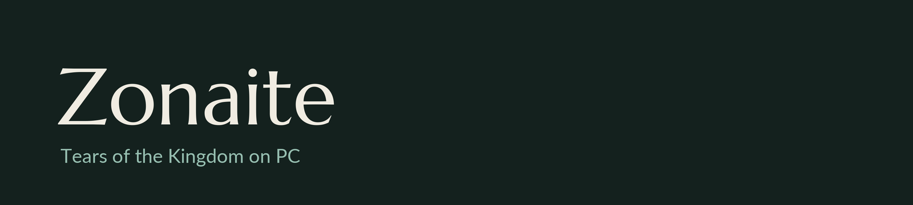

  

Zonaite lets you play **The Legend of Zelda: Tears of the Kingdom** on Windows as a real PC program. It isn't an
emulator. The game is rebuilt for your PC from your own copy, so it runs like any other PC game.

No game files come with Zonaite. You bring your own copy, and it stays on your computer.

## What you get

- The game runs at its normal 30 fps, and Zonaite adds frames in between, so it looks like up to 120 fps on a
  fast monitor. The game itself plays exactly the same.
- You can run it at several times the original resolution, and there's sharpening, texture filtering and colour
  settings.
- F1 (or holding View + Menu on a controller) opens the settings. Changes apply right away, no restart needed.
- Xbox-style controllers work, rumble included, and so do keyboard and mouse. You can rebind everything.
- You can play the latest update (1.2.1) or the original release (1.0.0), which still has the glitches the updates
  patched out. The two keep separate saves.
- F3 hides the HUD and F12 takes a screenshot.

## What you need

- Windows 10 or 11, 64-bit
- A graphics card with Vulkan support (any recent NVIDIA, AMD or Intel card)
- Your own copy of Tears of the Kingdom, dumped from your own Switch
- About 30 GB of free space
- [Python 3](https://www.python.org/downloads/) and [LLVM](https://github.com/llvm/llvm-project/releases)
  (tick "Add to PATH" when installing both), plus the
  [Visual Studio Build Tools](https://visualstudio.microsoft.com/visual-cpp-build-tools/) with
  "Desktop development with C++". Zonaite uses these to rebuild the game on your PC.

## Getting started

1. Download Zonaite and unzip it anywhere.
2. Open **Zonaite.exe**.
3. The first time, it walks you through making a dump of your game with Ryujinx and asks where you saved it.
4. Pick a version and press **Play**.

The very first start of each version takes 10 to 20 minutes while Zonaite rebuilds the game for your PC. After
that it starts right away.

## Controls

On a controller, buttons sit where they do on a Switch controller (the bottom button is B). You can switch to
Xbox labels in the settings.

On a keyboard: **WASD** to move, **IJKL** or the mouse for the camera, **E** for A, **Q** for B, **Space** for X,
**F** for Y, **1** and **3** for L and R, **Z** and **C** for ZL and ZR (the left mouse button is ZR and the
right one R), **Enter** for +, **Backspace** for -, and the arrow keys for the D-pad.

| Key | Does |
|---|---|
| F1 | Settings |
| F3 | Hide the HUD |
| F11 or Alt+Enter | Fullscreen |
| F12 | Screenshot |

## Questions

**Is this legal?** Zonaite contains no part of the game. You need your own copy, dumped from your own console, and
everything made from it stays on your PC. Please don't share dumps or anything Zonaite builds from them.

**Where are my saves?** In `%APPDATA%\Zonaite`. The Saves button in the launcher opens the folder.

**Something looks wrong or crashed.** Open an issue with what happened and the `zonaite.log` file from the Zonaite
folder.

## Thanks

Zonaite's graphics and audio code comes from the [Eden](https://github.com/eden-emulator/mirror) emulator, and its
menus use [Dear ImGui](https://github.com/ocornut/imgui). The fonts are Marcellus and Lato. The full list is in
[THIRD_PARTY.md](THIRD_PARTY.md), and how it all works is in [docs/DEVELOPMENT.md](docs/DEVELOPMENT.md).

Zonaite is free software under the GPL v3 ([LICENSE](LICENSE)). It isn't made by or affiliated with Nintendo.
The Legend of Zelda and Tears of the Kingdom are trademarks of Nintendo.
